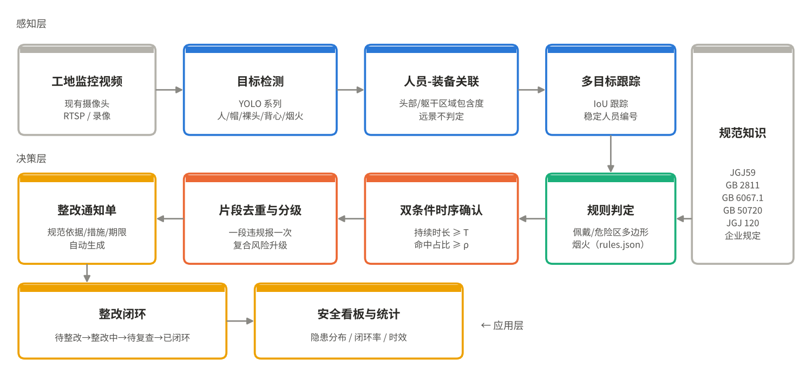
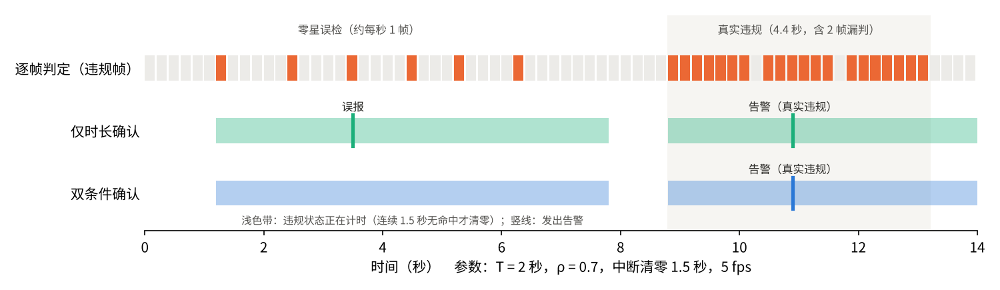
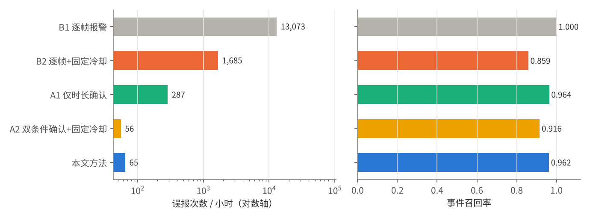
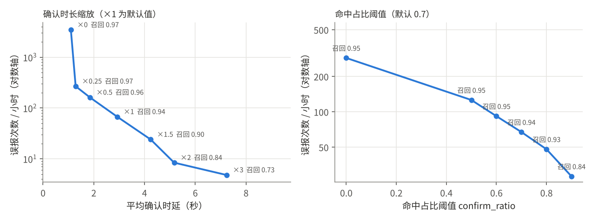
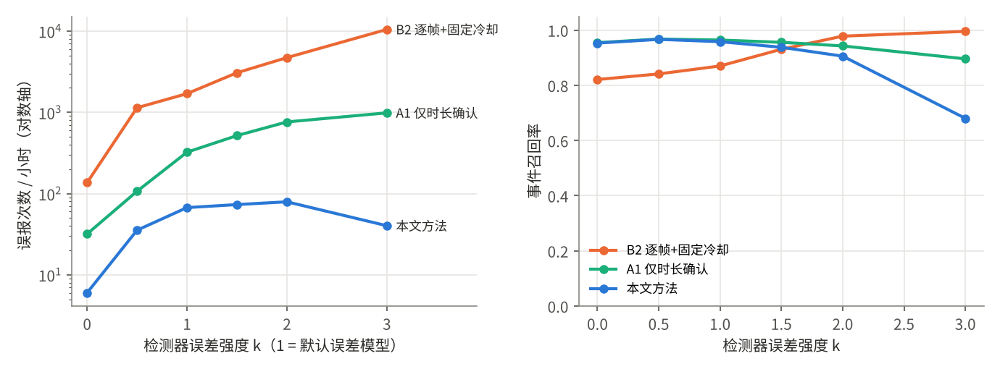
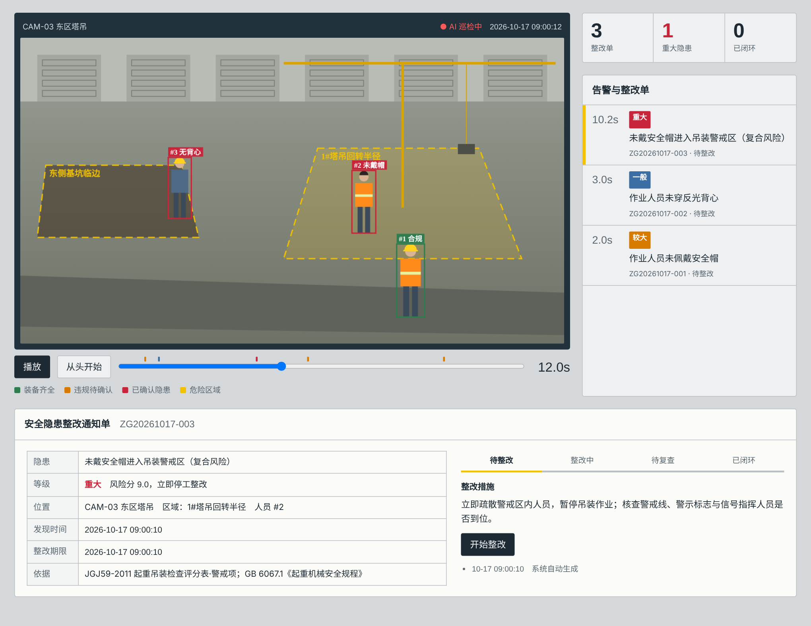

# 摘要

建筑施工长期是生产安全事故的高发领域，高处坠落、物体打击、起重伤害等事故的直接原因往往是作业人员未按规定佩戴防护用品、违规进入危险区域。工地普遍装有视频监控，但视频主要用于事后调阅；已有的视觉识别产品多采用逐帧报警，在遮挡、远景和检测器误差下告警数量过多，安全员难以处理，形成“告警疲劳”，识别结果也缺少与整改流程的衔接。

针对上述问题，本文设计并实现了“筑安智检”施工现场安全隐患智能巡检与整改闭环系统。系统复用工地现有摄像头，由目标检测、人员—装备空间关联、多目标跟踪、配置化规则判定、告警决策和整改工单六个环节组成。在告警决策环节，本文提出三项方法：（1）**双条件时序确认**，违规状态须同时满足持续时长不少于 $T$ 且该时段内命中帧占比不低于 $\rho$ 才确认为隐患，既过滤单帧误检，也过滤被“中断清零”机制串联起来的零星误检；（2）**片段级去重**，一段连续违规只告警一次，持续违规定时提醒，新的违规片段只需与上次告警间隔较短的重新布防时间，避免固定冷却期吞掉同一人的第二次违规；（3）**复合风险升级**，同一人员同时存在多项已确认违规（如未戴安全帽且位于塔吊回转区）时叠加风险分并单独发出“重大”级升级告警。每条规则绑定《建筑施工安全检查标准》（JGJ59—2011）等规范的检查项与整改措施，告警自动生成整改通知单，并按“待整改—整改中—待复查—已闭环”状态机跟踪。

由于真实工地视频缺乏逐帧的时间真值，本文构建了带真值的工地场景仿真器和可调的检测器误差模型，在 20 个随机场景（共 3.3 小时、约 2100 个真值隐患事件）上进行了对比与消融实验。结果表明：与逐帧报警和“逐帧+固定冷却”两种常见策略相比，本文方法将误报从每小时 13073.4 次和 1685.4 次降至 65.1 次（分别减少 99.5% 和 96.1%），告警精确率由 0.403 提升到 0.938，事件召回率由 0.859 提升到 0.962，平均确认时延 3.02 秒；消融实验显示命中占比条件使误报再减少 77.3%，片段级去重使召回率提高 4.6 个百分点。系统核心引擎为纯 Python 实现、无第三方依赖，附带可离线运行的可视化演示和 13 项单元测试，代码与实验全部开源可复现。

**关键词：** 施工安全；安全帽检测；计算机视觉；告警疲劳；时序确认；隐患整改闭环

# 1 引言

## 1.1 研究背景

建筑业是我国国民经济的支柱产业，也是生产安全事故的高发行业。住房和城乡建设部办公厅关于 2019 年房屋市政工程生产安全事故情况的通报显示，当年全国共发生房屋市政工程生产安全事故 773 起、死亡 904 人；其中高处坠落 415 起，占 53.69%；物体打击 123 起，占 15.91%；土方、基坑坍塌 69 起，占 8.93%；起重机械伤害 42 起，占 5.43%[1]。这几类事故合计超过八成，而它们的直接诱因中，相当一部分可以在事故发生前从现场画面中观察到：作业人员未戴安全帽、未系安全带、在吊装作业时进入警戒区、在基坑临边逗留等。

现场的安全管理目前主要依靠安全员人工巡查。一名安全员需要覆盖整个作业面，巡查存在盲区和时间空档；工地虽然普遍按要求安装了视频监控，但这些视频大多只在事故发生后用于调阅取证。近年来，基于深度学习的目标检测技术已能较准确地识别安全帽等个人防护用品[2–4]，部分厂商也推出了“AI 安全帽识别”类产品。然而在实际使用中，这类系统普遍面临两个问题。

第一是**报不准**。检测器在遮挡、背光、远景、人员转身等情况下会出现类别翻转（把戴帽识别为未戴帽）和漏检。若对每一帧的判定结果直接报警，一个持续 30 秒的违规会产生上百条重复告警，而检测器的零星误判又会凭空产生告警。医疗监护等领域的研究表明，大量无效告警会使值守人员对告警失去敏感，即“告警疲劳”[5]。施工现场同样如此：当安全员发现大多数告警是误报或重复时，系统很快就会被弃用。

第二是**管不住**。识别结果停留在“画面上画一个框”，发现隐患后依靠口头通知或即时通讯群转发，整改是否落实、是否复查，缺少记录和追溯，难以形成闭环，也难以支撑考核与分析。

## 1.2 本文工作

本文面向“人工智能+场景·建造”赛题，设计并实现了“筑安智检”系统，目标是让 AI 识别结果真正进入安全员的日常工作流程。主要工作和创新点如下：

1. **双条件时序确认方法。** 分析了仅按持续时长确认的告警策略在检测噪声下的失效机理：为容忍检测器的短暂漏判，确认逻辑通常允许违规状态在短时间中断后继续计时，这一机制会把间隔不长的零星误检“串”成一段看似持续的违规。本文在持续时长之外增加命中帧占比条件，并给出了两种策略误确认概率的定量分析。

2. **片段级去重与复合风险升级。** 以“违规片段”而非固定时间窗为单位去重，持续违规定时提醒；对同一人员同时存在的多项已确认违规进行风险叠加和升级告警，使“未戴安全帽进入吊装区”这类高危组合能被单独识别并要求立即停工。

3. **规范驱动的整改闭环。** 将每条识别规则与 JGJ59—2011、GB 2811、GB 6067.1、GB 50720、JGJ 120 等规范的检查项及整改措施绑定，以配置文件形式维护；告警自动生成整改通知单，经状态机跟踪至闭环，并输出统计看板。

4. **可复现的定量评估方法。** 构建了带逐帧真值的工地场景仿真器和可调检测器误差模型，定义了事件级召回率、每小时误报数、每事件告警数等面向“告警可用性”的指标，在相同输入上对两种基线、两种消融变体和本文方法进行了对比，并扫描了参数敏感性和检测器误差强度。

本文其余部分安排如下：第 2 节综述相关工作；第 3 节介绍系统总体设计；第 4 节详细阐述关键方法；第 5 节给出实验设计与结果；第 6 节介绍系统实现与演示；第 7 节讨论局限性与改进方向；第 8 节总结全文。

# 2 相关工作

## 2.1 施工现场视觉安全监测

利用计算机视觉进行施工安全与健康监测的研究已持续十余年。Seo 等[6]系统梳理了该领域的技术路线，将其归纳为目标检测、目标跟踪和动作识别三类基础任务，并指出现场遮挡、光照变化和人员密集是主要难点。深度学习兴起后，Fang 等[2]采用 Faster R-CNN 从远景监控视频中检测未佩戴安全帽的人员；Wu 等[3]构建了安全帽佩戴检测基准数据集并提出改进的检测方法；Nath 与 Behzadan[4]基于 YOLO 系列模型实现了个人防护用品的实时检测。公开数据集方面，SHWD 安全帽佩戴数据集[7]提供了“戴帽头部”与“裸头”两类标注，被国内研究广泛使用。

在行为层面，Kong 等[8]结合计算机视觉与长短期记忆网络预测施工人员的不安全行为，说明利用时间维度信息可以提升判断的可靠性。

上述工作主要关注**单帧或短片段的识别精度**，以检测 mAP 等指标衡量。而一个可用的现场系统还需要回答：识别结果在什么时候、以什么频率变成一条告警？告警如何对应到规范和整改动作？这正是本文关注的“识别之后”的问题。

## 2.2 目标检测与多目标跟踪

YOLO 系列[9]将目标检测建模为单阶段回归问题，在速度和精度之间取得了良好平衡，其后续版本（如 Ultralytics YOLOv8[10]）提供了完整的训练与部署工具链，适合在工地边缘设备上运行。多目标跟踪方面，SORT[11]以卡尔曼滤波和 IoU 匹配实现了轻量的在线跟踪，ByteTrack[12]进一步利用低置信度检测框提升了遮挡场景下的跟踪连续性。本文的跟踪模块采用 IoU 匹配的轻量实现，接口上可替换为 ByteTrack。

## 2.3 告警疲劳

“告警疲劳”最早在医院监护领域被系统研究。Cvach[5]的综述指出，监护设备产生的告警中绝大多数不需要临床干预，大量无效告警会导致医护人员调低音量、关闭告警或延迟响应，反而危及安全。其提出的缓解思路包括：设置告警延迟、按持续时间过滤短暂异常、按严重程度分级等。本文将这些思路迁移到施工场景，并针对视觉检测器特有的“零星误检”和“遮挡突发”两类噪声设计了双条件确认机制。

## 2.4 规范依据

我国施工现场安全检查以《建筑施工安全检查标准》JGJ59—2011[13]为主要依据，其各分项检查评分表规定了安全帽、警戒区、临边防护等检查项。安全帽产品要求见 GB 2811—2019[14]；起重作业安全要求见 GB 6067.1—2010[15]；施工现场消防见 GB 50720—2011[16]；基坑支护见 JGJ 120—2012[17]。本文将这些规范的检查项与整改要求结构化，作为规则的依据字段。

# 3 系统总体设计

## 3.1 设计目标

结合现场调研中安全员反映的问题，系统确定了以下设计目标：

- **复用现有设施**：直接接入工地已有监控摄像头，不新增前端硬件；
- **告警可用**：每条告警都应大概率对应一个真实隐患，同一隐患不反复告警，重大风险优先突出；
- **依据明确**：每条告警给出规范依据和整改措施，安全员可直接据此下达整改；
- **全程留痕**：从发现到闭环的每一步有时间记录，便于追溯和统计；
- **可配置、可替换**：规则、阈值、规范依据由项目按需调整；检测模型可随数据积累替换升级。

## 3.2 总体架构

系统分为感知层、决策层和应用层（图 1）。



**感知层**从视频流中按固定帧率抽帧，由目标检测模型输出人员、安全帽（戴帽头部）、裸头、反光背心、火焰、烟雾六类目标框；人员—装备关联模块按空间关系把装备框归属到具体人员，得到每个人的佩戴状态；跟踪模块为人员分配跨帧稳定的编号。

**决策层**由规则判定、双条件时序确认、片段去重与风险分级三部分组成。规则判定逐帧给出“哪个对象违反了哪条规则”的原始命中；时序确认把原始命中转化为“已确认的隐患”；去重与分级决定是否以及以何种等级发出告警。

**应用层**把告警转化为整改通知单，跟踪整改流程，并汇总统计。规范知识（规则库）以配置文件形式贯穿决策层和应用层。

## 3.3 数据流与核心数据结构

一帧数据在系统中依次经历以下形态：检测框集合 $\{(l_i, c_i, b_i)\}$（类别、置信度、边界框）→ 人员集合 $\{(b_j, h_j, v_j, id_j)\}$（人体框、是否戴帽、是否穿背心、跟踪编号，其中 $h_j, v_j \in \{\text{是}, \text{否}, \text{未知}\}$）→ 原始命中集合 $\{(r, s)\}$（规则编号、对象）→ 告警 $(r, s, t, \text{等级}, \text{风险分})$ → 整改通知单。

规则以 JSON 配置维护，每条规则包含：编号、名称、类型（未戴安全帽/未穿背心/区域闯入/烟火）、严重度、确认时长 $T_r$、规范依据、整改措施；区域闯入类规则还指定适用的危险区类型。全局配置包括命中占比阈值 $\rho$、去重参数和风险等级划分。表 1 列出了默认规则。

表 1　默认规则配置

| 编号 | 规则 | 严重度 | 确认时长 $T_r$ | 主要依据 |
|---|---|---|---|---|
| R01 | 作业人员未佩戴安全帽 | 5 | 2 秒 | JGJ59—2011 高处作业检查评分表·安全帽项；GB 2811 |
| R02 | 作业人员未穿反光背心 | 2 | 3 秒 | 项目现场安全管理规定（可配置） |
| R03 | 人员进入塔吊回转/吊装警戒区 | 6 | 1 秒 | JGJ59—2011 起重吊装检查评分表·警戒项；GB 6067.1 |
| R04 | 人员在基坑临边危险区域滞留 | 5 | 5 秒 | JGJ59—2011 基坑工程检查评分表·临边防护项；JGJ 120 |
| R05 | 施工现场出现明火/烟雾 | 7 | 2 秒 | GB 50720—2011 |
| 复合 | 未戴安全帽进入吊装警戒区 | R03 + 3 | — | 同 R01、R03 |

确认时长的设定体现规则语义：进入塔吊回转区本身即属违规，需尽快提醒，取 1 秒；“基坑临边滞留”强调逗留而非经过，取 5 秒；未穿反光背心风险较低且背心检测误差较大，取 3 秒。

# 4 关键方法

## 4.1 人员—装备空间关联

通用检测模型输出的人员框和装备框彼此独立，需要判断某顶安全帽属于哪个人。设人员框 $b_p = (x_1, y_1, x_2, y_2)$，高 $H = y_2 - y_1$，宽 $W = x_2 - x_1$。定义其头部区域和躯干区域：

$$
R_h(b_p) = \left(x_1 - 0.1W,\; y_1 - 0.08H,\; x_2 + 0.1W,\; y_1 + 0.28H\right)
$$

$$
R_t(b_p) = \left(x_1,\; y_1 + 0.18H,\; x_2,\; y_1 + 0.70H\right)
$$

装备框 $b_e$ 与区域 $R$ 的包含度定义为 $C(b_e, R) = |b_e \cap R| / |b_e|$。与常用的 IoU 相比，包含度不受装备框与人体框尺寸悬殊的影响。关联按人员置信度从高到低进行：每个人在头部区域内选取包含度最大且超过 $\tau_m = 0.5$ 的安全帽框；若没有，再寻找裸头框；已被认领的装备框不再参与匹配，避免相邻两人“共用”一顶安全帽。据此得到佩戴状态：

- 匹配到安全帽框 → 戴帽；匹配到裸头框 → 未戴帽；两者都没有 → **未知**（遮挡或检测失败）；
- 躯干区域匹配到背心框 → 穿背心，否则 → 未穿。

当人体框高度小于 48 像素（远景）时，头部细节不足以可靠判断，佩戴状态一律记为未知。“未知”不触发任何规则，这一设计把检测器的不确定性显式保留下来，而不是强行二值化。

## 4.2 多目标跟踪与危险区判定

跟踪采用贪心 IoU 匹配：当前帧每个人员与上一帧各轨迹计算 IoU，取大于 0.3 的最大者继承其编号，否则新建轨迹；轨迹连续 5 帧未被匹配即删除。

危险区以图像平面上的多边形标定（如塔吊回转半径在地面的投影、基坑临边带）。判断人员是否位于区域内时，取人体框底边中点 $p = ((x_1 + x_2)/2,\; y_2)$ 作为“脚底点”，用射线法判断 $p$ 是否在多边形内。相比框中心，脚底点更接近人员实际站立的地面位置，可减少因透视造成的误判。

## 4.3 双条件时序确认

### 4.3.1 问题分析

规则判定逐帧给出原始命中。设对象 $s$ 在第 $f$ 帧（时刻 $t_f$）是否命中规则 $r$ 为 $x_f \in \{0, 1\}$。最直接的确认策略是：违规状态持续 $T_r$ 秒后确认。由于检测器会出现短暂漏判（如真实违规中有一两帧没检出裸头），实际实现中需要允许状态中断一小段时间 $\Delta_g$（本文取 1.5 秒）而不清零。

问题在于，这个容忍机制会被零星误检利用。设某人始终戴着安全帽，但检测器每帧以概率 $p$ 独立地误判为裸头。只要相邻两次误判的间隔不超过 $\Delta_g$，状态就不会清零；一旦从第一次误判算起的时间达到 $T_r$，就会被确认为违规。此时状态的“持续时长”很长，但其中绝大多数帧其实是合规的。图 2 给出了一个直观例子：大约每秒一帧的零星误检被“仅时长确认”判定为违规并告警，而真实违规中的两帧漏判则不应影响确认。



### 4.3.2 方法

为每个（规则，对象）对维护状态 $\sigma = (t_s, t_l, f_s, n)$：状态起始时刻、最近一次命中时刻、起始帧号、累计命中帧数。第 $f$ 帧的更新规则为：

- 若 $x_f = 1$：当状态不存在或 $t_f - t_l > \Delta_g$ 时，新建状态 $(t_f, t_f, f, 1)$；否则令 $t_l \leftarrow t_f$，$n \leftarrow n + 1$；
- 若 $t_f - t_l > \Delta_g$，删除状态。

确认条件为持续时长与命中占比**同时**满足：

$$
\text{confirmed}(r, s, f) \iff (t_f - t_s \ge T_r) \;\wedge\; \frac{n}{f - f_s + 1} \ge \rho
$$

其中 $\rho$ 为命中占比阈值（默认 0.7）。占比条件要求在计时窗口内大部分帧都判定为违规，零星误检串成的状态占比很低，无法通过；而真实违规即使有少量漏判，占比仍然很高。

### 4.3.3 误确认概率分析

以 5 fps、$T_r = 2$ 秒为例，确认窗口至少包含 $N = 11$ 帧。设检测器对一个合规人员每帧独立误判的概率为 $p = 0.05$。

**仅时长确认**：需要从某次误判起，后续误判之间的间隔都不超过 $\Delta_g$（7 帧），且链条跨度达到 10 帧。下一次误判在 7 帧内出现的概率为 $1 - 0.95^7 \approx 0.30$，跨越 10 帧通常只需要再出现 1～2 次这样的接续，因此每次误判引发误确认的概率在 $0.3^2 \approx 0.09$ 到 $0.3$ 的量级。

**双条件确认**：除上述条件外，还需窗口内至少 $\lceil 0.7 \times 11 \rceil = 8$ 帧命中。其概率不超过

$$
P\left(\text{Bin}(11, 0.05) \ge 8\right) \approx \binom{11}{8} \times 0.05^8 \approx 6.4 \times 10^{-9}
$$

两者相差数个数量级。这说明对**独立的**零星误检，占比条件几乎可以完全将其过滤。剩余的误报主要来自**相关的**持续性误差，例如人员长时间低头、被钢筋或模板遮挡导致连续多帧误判。这类“遮挡突发”在第 5 节的误差模型中单独建模，也是本文方法残余误报的主要来源（见 5.4 节）。

## 4.4 片段级去重

确认之后，还需决定何时发出告警。常见做法是固定冷却期：同一对象同一规则在冷却期（如 60 秒）内只告警一次。这种做法有一个隐蔽的缺陷：若某工人摘下安全帽 20 秒后戴上，40 秒后又摘下，第二次违规会落在冷却期内而被吞掉；进出吊装区的情况更为常见。

本文改为以“违规片段”为单位去重：一个状态（即一段连续违规）从产生到清零只告警一次；若违规持续超过 $P$ 秒（默认 300 秒）仍未消除，则再发一次提醒；状态清零后出现的新片段，只要距上次告警超过重新布防时间 $R$（默认 10 秒）即可告警。$R$ 的作用是防止跟踪编号切换等原因导致同一违规在短时间内被重复告警。系统同时保留传统固定冷却模式，供项目按需切换。

## 4.5 风险分级与复合风险升级

每条告警的风险分为 $S = s_r + \sum_k \beta_k$，其中 $s_r$ 为规则严重度，$\beta_k$ 为命中的复合规则加分。按风险分划分三个等级（表 2），等级决定整改期限。

表 2　风险等级与整改要求

| 等级 | 风险分 | 整改期限 | 要求 |
|---|---|---|---|
| 重大 | $S \ge 8$ | 立即 | 立即停工整改 |
| 较大 | $5 \le S < 8$ | 4 小时 | 限时整改 |
| 一般 | $S < 5$ | 24 小时 | 当日整改 |

单项违规的风险可以通过叠加而急剧上升。例如在吊装作业区内未戴安全帽，一旦发生物体打击，后果远比两项违规单独发生时严重。复合规则定义为一组规则 $\mathcal{C}$ 及加分 $\beta$。设 $r^* = \arg\max_{r \in \mathcal{C}} s_r$ 为组内最严重的规则（主规则），当同一对象 $s$ 满足

$$
\forall r \in \mathcal{C}:\; \text{confirmed}(r, s, f)
$$

时，系统以主规则的名义发出一条风险分为 $s_{r^*} + \beta$ 的升级告警（默认配置下 $6 + 3 = 9$，即“重大”）。若此时主规则恰好是首次确认，则只发升级告警，不再重复发出普通告警；若主规则此前已按“较大”发出过告警，则升级告警作为一条新告警发出，提醒安全员风险已经升级。每个违规片段对每条复合规则只升级一次。要求组内**每条**规则都已确认（而非仅仅处于计时状态），是为了避免检测噪声造成虚假升级。

## 4.6 整改通知单与闭环

每条告警生成一张整改通知单，包含：编号、项目、摄像头与区域、隐患描述、等级与风险分、发现时间、整改期限、规范依据、整改措施、责任人、状态与处理记录。通知单状态按如下状态机流转：

$$
\text{待整改} \rightarrow \text{整改中} \rightarrow \text{待复查} \rightarrow \text{已闭环}
$$

复查不通过时由“待复查”退回“整改中”，并记录原因。每次状态变化都记录时间，从而可以统计整改时效、闭环率、各类隐患的分布和高发区域，为班前教育和安全考核提供依据。

# 5 实验

## 5.1 实验设计思路

评价告警策略需要知道每个隐患事件**何时开始、何时结束、属于谁**，从而判断一条告警是对应真实事件、重复告警还是误报。真实工地视频难以获得这种逐帧的时间真值，人工标注成本也很高。因此本文采用“仿真世界 + 检测器误差模型”的评估方法：先生成带完整真值的工地场景，再按可调的误差模型生成检测器输出，在相同输入上比较不同策略。这一方法的优点是可控、可复现，并且可以系统地改变检测器质量；其局限在 7.1 节讨论。

## 5.2 实验设置

**场景生成。** 每个场景时长 10 分钟，5 fps（共 3001 帧），画面 1280×720，包含 6 名工人、1 个塔吊回转区和 1 个基坑临边区。工人在若干位置之间行走（速度 60～110 像素/秒）并停留（2～18 秒），每次移动以 0.22 的概率选择危险区内的目标点；人体框高度按透视关系随纵坐标变化（约 125～180 像素）。每名工人的未戴安全帽片段按泊松过程产生（平均每分钟 0.35 次，持续 4～40 秒），未穿背心片段平均每分钟 0.25 次（持续 6～60 秒）；危险区进出由真实轨迹几何确定；烟火片段平均每分钟 0.08 次（持续 6～25 秒）。

**检测器误差模型。** 表 3 列出了默认误差参数（误差强度 $k = 1$）。其中“遮挡突发”模拟长时间低头、被遮挡等导致的连续误判，突发长度服从均值 4 帧的指数分布。误差强度扫描时，各概率乘以 $k$，框抖动标准差乘以 $\max(1, k)$。

表 3　检测器误差模型默认参数（逐帧）

| 误差类型 | 概率/参数 |
|---|---|
| 人体漏检 | 0.05 |
| 安全帽/裸头类别翻转（独立） | 0.05 |
| 进入遮挡突发 | 0.01，突发期间头部判断持续出错 |
| 头部框漏检（判为未知） | 0.08 |
| 背心框漏检（判为未穿） | 0.06 |
| 背心误检 | 0.03 |
| 无烟火时烟雾误报 | 0.002 |
| 框抖动 | 标准差 4 像素 |

**真值事件与匹配。** 持续不少于 3 秒的违规片段计为真值隐患事件；短于 3 秒的瞬时违规（如快速穿过危险区）既不计入召回分母，与之匹配的告警也不计为误报（视为中性）。一条告警若规则类型一致、通过人体框 IoU（>0.3）关联到同一名工人，且告警时刻落在 $[t_{\text{start}} - 1, t_{\text{end}} + 2]$ 秒内，即匹配该事件。前向 1 秒容差用于吸收框抖动使脚底点提前越过区域边界的情况。

**评价指标。** 设真值事件集合为 $E$，告警集合为 $A$，其中匹配到真值事件的告警为 $A_m$，既不匹配真值事件也不匹配瞬时违规的为误报 $A_f$，被至少一条告警命中的事件为 $E_h$：

- 事件召回率 $= |E_h| / |E|$；
- 每小时误报数 $= |A_f| / \text{时长}$；
- 告警精确率 $= |A_m| / (|A_m| + |A_f|)$；
- 每事件告警数 $= |A_m| / |E_h|$，衡量重复告警程度，理想值接近 1；
- 平均确认时延 $=$ 各命中事件首条告警时刻与事件开始时刻之差的均值。

**对比策略。** 两个基线：B1 逐帧报警（每帧判定违规即告警）；B2 逐帧 + 固定冷却（各规则冷却 30～120 秒，代表常见商用做法）。两个消融变体：A1 仅时长确认（去掉命中占比条件，保留片段去重）；A2 双条件确认 + 固定冷却（把片段去重换回固定冷却）。各策略使用相同的关联与跟踪模块和相同的规则判定。

实验一使用 20 个随机种子（共 3.33 小时）；实验二、三各使用 10 个种子。所有结果可通过 `python scripts/run_experiments.py` 复现。

## 5.3 实验一：策略对比与消融

表 4 和图 3 给出了五种策略的结果（均值 ± 标准差）。

表 4　不同告警策略的对比（20 个场景，默认误差强度）

| 策略 | 事件召回率 | 误报（次/小时） | 告警精确率 | 每事件告警数 | 平均确认时延（秒） |
|---|---|---|---|---|---|
| B1 逐帧报警 | 1.000 ± 0.000 | 13073.4 ± 482.8 | 0.790 ± 0.020 | 77.08 ± 3.90 | 0.06 ± 0.01 |
| B2 逐帧+固定冷却 | 0.859 ± 0.027 | 1685.4 ± 124.4 | 0.403 ± 0.029 | 2.06 ± 0.19 | 2.97 ± 0.85 |
| A1 仅时长确认 | 0.964 ± 0.019 | 287.4 ± 35.1 | 0.771 ± 0.031 | 1.57 ± 0.07 | 2.80 ± 0.14 |
| A2 双条件确认+固定冷却 | 0.916 ± 0.028 | 56.1 ± 15.0 | 0.940 ± 0.015 | 1.50 ± 0.08 | 3.48 ± 0.29 |
| **本文方法** | **0.962 ± 0.020** | **65.1 ± 15.0** | **0.938 ± 0.013** | **1.59 ± 0.08** | **3.02 ± 0.21** |



**基线的问题。** B1 召回了全部事件，但平均每个事件产生 77 条告警，每小时误报超过 1.3 万次，完全不可用。B2 通过冷却期把重复告警降到每事件约 2 条，但误报仍有每小时 1685 次，精确率只有 0.403，即六成告警是误报；同时召回率降至 0.859。原因是早先的误报或前一段违规的告警占用了冷却期，使后续真实事件被抑制或推迟告警；B2 虽然没有确认环节，平均时延却达到 2.97 秒，也说明了这一点。

**本文方法的效果。** 与 B2 相比，本文方法误报减少 96.1%（1685.4 → 65.1 次/小时），精确率从 0.403 提高到 0.938，召回率从 0.859 提高到 0.962，代价是平均约 3 秒的确认时延。对于施工安全隐患而言，3 秒的确认时延远小于安全员赶到现场所需的时间，可以接受。

**消融分析。** A1 与本文方法的唯一区别是去掉命中占比条件，其误报为每小时 287.4 次，本文方法比其减少 77.3%，召回率基本持平（0.964 与 0.962），说明占比条件以极小的召回代价过滤了大部分误报，与 4.3.3 节的分析一致。A2 与本文方法的唯一区别是用固定冷却替代片段去重：A2 召回率为 0.916，本文方法提高 4.6 个百分点，误报相应增加每小时 9 次，属于合理的取舍。

表 5 给出了分规则的结果。本文方法在未戴安全帽、未穿背心两类佩戴规则上的提升最明显：B2 在这两类规则上每小时误报 834.3 次和 797.1 次，本文方法分别降至 60.9 次和 3.0 次。未戴安全帽的残余误报明显高于其他规则，主要来自遮挡突发造成的连续误判（见 5.4 节）。基坑临边规则的召回率（0.921）略低于 B2（0.927），这是因为该规则的确认时长为 5 秒，持续 3～5 秒的短暂停留不会被确认，这正是“滞留”规则的设计意图。

表 5　分规则结果（B2 与本文方法）

| 规则 | 真值事件数（每场景均值） | 召回率 B2 | 召回率 本文 | 误报/小时 B2 | 误报/小时 本文 |
|---|---|---|---|---|---|
| 未戴安全帽 | 19.6 | 0.735 | 0.980 | 834.3 | 60.9 |
| 未穿反光背心 | 13.8 | 0.762 | 0.980 | 797.1 | 3.0 |
| 进入塔吊区 | 47.0 | 0.907 | 0.972 | 19.5 | 1.2 |
| 基坑临边滞留 | 25.8 | 0.927 | 0.921 | 13.5 | 0.0 |
| 烟火 | 1.1 | 0.594 | 1.000 | 21.0 | 0.0 |

**复合风险升级。** 20 个场景中共有 179 个真值复合风险事件（同一工人未戴安全帽片段与位于塔吊区的时间重叠不少于 1 秒）。本文方法将其中 143 个升级为“重大”告警，召回率 0.799；误升级 45 次，即每小时 13.5 次。未升级的事件多为工人在塔吊区停留时间很短，安全帽规则尚未确认就已离开；误升级主要来自遮挡突发造成的安全帽规则误确认。复合升级的准确率直接受单项规则准确率制约，是后续改进的重点（见 7.2 节）。

## 5.4 实验二：参数敏感性

图 4 左图将各规则的确认时长统一乘以缩放系数，绘制平均确认时延与每小时误报数之间的关系。缩放系数为 0（即只要占比条件成立就确认）时，误报高达每小时 3450 次；系数增至 0.25 时误报骤降至 267.6 次，召回率几乎不变（0.967）；继续增大，误报近似按指数下降，而召回率和时延的代价逐渐增大：系数为 2 时误报为 8.4 次/小时，但召回率降至 0.842，时延为 5.2 秒。默认配置（系数 1）误报 67.2 次/小时、召回率 0.940、时延 2.9 秒，处于曲线的拐点附近。



图 4 右图固定确认时长，扫描命中占比阈值 $\rho$。$\rho$ 从 0 增至 0.7 时，误报从每小时 287.4 次降至 67.2 次，召回率仅从 0.948 降至 0.940；$\rho$ 继续增至 0.9 时，误报降至 28.2 次，但召回率下降到 0.844。这是因为真实违规期间也会因头部框漏检（判为未知）和类别翻转出现非命中帧，阈值过高会把真实违规也拒绝掉。综合考虑，默认取 $\rho = 0.7$。

上述曲线也为不同项目的参数选择提供了依据：对误报容忍度低的场景（如告警直接推送给项目经理）可适当提高确认时长；对时效要求高的规则（如塔吊区闯入）则保持较短的确认时长。

## 5.5 实验三：对检测器误差的鲁棒性

图 5 将检测器误差强度 $k$ 从 0 扫描到 3，比较 B2、A1 和本文方法（不含复合升级）。$k = 0$ 表示没有类别翻转和漏检，但仍保留框抖动及人员相互遮挡造成的关联、跟踪误差。



随着 $k$ 增大，B2 的误报从每小时 136.2 次迅速增长到 10484.4 次，A1 从 31.8 次增长到 985.8 次，本文方法始终保持在每小时 6.0～79.2 次之间，在 $k = 3$ 时仍只有 40.2 次，精确率在所有误差强度下均不低于 0.92。B2 的召回率随 $k$ 增大反而上升（$k = 3$ 时为 0.995），这并非性能提升，而是大量误报碰巧落入真实事件的时间窗，其精确率同时跌至 0.349。

本文方法的局限在于：当检测器质量很差（$k = 3$）时，真实违规期间的命中占比也会下降到阈值以下，召回率降至 0.680。这说明命中占比阈值应与检测器的实际质量匹配。在实际部署中，可以用少量标注视频估计检测器在该工地的误判率，再据此设定 $\rho$；或者随着检测模型迭代提升而逐步提高阈值（见 7.2 节）。

## 5.6 小结

实验表明：（1）告警策略对系统可用性的影响不亚于检测精度本身，同一检测器输出下，误报可相差两个数量级；（2）命中占比条件是过滤检测噪声的关键，单靠持续时长不足以应对零星误检；（3）片段级去重避免了固定冷却期对重复违规的漏报；（4）复合风险升级能识别八成左右的高危组合，但其准确率受单项规则制约。

# 6 系统实现与演示

## 6.1 软件实现

系统核心以 Python 实现，不依赖任何第三方库，便于在工控机或边缘计算设备上部署。主要模块如表 6 所示。

表 6　主要模块

| 模块 | 功能 |
|---|---|
| `detectors.py` | 检测器适配层：接入 Ultralytics YOLO 权重，统一类别标签；离线回放标注数据 |
| `association.py` | 人员—装备空间关联（4.1 节） |
| `tracker.py` | IoU 多目标跟踪（4.2 节） |
| `engine.py` | 规则判定、双条件时序确认、片段去重、复合风险升级（4.2～4.5 节） |
| `rules.json` | 规则、阈值、规范依据与整改措施配置 |
| `tickets.py` | 整改通知单生成与状态机（4.6 节） |
| `sim.py`、`evaluate.py` | 场景仿真器、检测器误差模型与评估指标（第 5 节） |

系统提供命令行入口：`python -m siteguard run` 回放标注数据并输出整改通知单（Markdown 与 JSON）及统计；`python -m siteguard yolo` 接入 YOLO 权重处理真实视频。项目包含 13 项单元测试，覆盖几何计算、关联、零星误检过滤、持续违规只报一次、复合升级的两种触发路径、工单状态流转及演示场景的端到端结果。

## 6.2 可视化演示

为便于展示和评审，项目提供了一个可在浏览器中直接打开的单文件演示页面（图 6）。页面回放一路模拟的塔吊区监控画面（30 秒，5 fps），实时绘制人员检测框（绿色为合规、橙色为违规待确认、红色为已确认隐患）、危险区域和烟雾；右侧显示告警流与统计；下方为选中告警对应的整改通知单，可点击按钮推进整改状态直至闭环。演示页的告警逻辑与 Python 引擎完全一致。



演示场景包含三名工人和一次烟雾：工人 #1 装备齐全，但第 3 秒有一帧被误检为裸头；工人 #2 始终未戴安全帽，并在约第 9 秒走入塔吊回转区；工人 #3 未穿反光背心，并在基坑临边逗留；第 22～25 秒出现烟雾。系统输出 5 张整改通知单（表 7），工人 #1 的单帧误检未产生任何告警。

表 7　演示场景生成的整改通知单

| 时刻 | 隐患 | 等级 | 说明 |
|---|---|---|---|
| 2.0 秒 | 作业人员未佩戴安全帽（#2） | 较大 | 未戴帽持续 2 秒后确认 |
| 3.0 秒 | 作业人员未穿反光背心（#3） | 一般 | 持续 3 秒后确认 |
| 10.2 秒 | 未戴安全帽进入吊装警戒区（#2） | 重大 | 安全帽规则已确认，进入塔吊区 1 秒后直接发出升级告警 |
| 14.0 秒 | 人员在基坑临边危险区域滞留（#3） | 较大 | 停留 5 秒后确认 |
| 24.0 秒 | 施工现场出现明火/烟雾 | 较大 | 持续 2 秒后确认 |

## 6.3 部署方案

实际部署时，系统以“一个工地一台边缘计算盒”的方式运行：边缘盒通过 RTSP 拉取各路摄像头视频，以 5 fps 抽帧推理；检测模型选用轻量 YOLO 模型并进行量化，以支持多路并发；告警与整改通知单同步到云端或项目部服务器，安全员通过手机端接收通知、上传整改照片并提交复查。视频画面在边缘端处理，云端只保存告警截图和工单记录，以减少带宽占用并保护作业人员隐私。危险区多边形在部署时由安全员在画面上标定，塔吊等移动设备的作业范围可按作业计划分时段启用（配置中的 `active` 字段）。

# 7 讨论

## 7.1 局限性

**仿真评估的局限。** 本文的定量结论来自仿真场景和参数化的误差模型。仿真能控制变量、提供精确真值，但真实工地的人员行为、遮挡模式和检测误差分布会更复杂，例如误差可能与光照、距离、人员姿态强相关，而不是本文假设的独立或简单突发。因此，表 4 中的绝对数值不能直接外推到真实工地，更有参考价值的是不同策略之间的**相对**差异，以及参数变化的**趋势**。

**检测模型尚未在真实数据上训练评估。** 本文的贡献集中在检测之后的决策和闭环环节，检测模块目前通过适配层接入 YOLO 系列模型，尚未在自采工地数据上完成训练和精度评估。

**规则覆盖有限。** 目前覆盖安全帽、反光背心、危险区和烟火四类规则，尚未覆盖安全带、临边防护设施缺失、物料堆放等需要更复杂视觉理解的检查项。

## 7.2 改进方向

1. **真实数据验证。** 以 SHWD 等公开数据集为基础，补充自采的工地图像（覆盖不同距离、光照和遮挡），训练检测模型并报告检测精度；在合作工地录制视频并人工标注事件起止时间，用真实数据重复第 5 节的策略对比。
2. **自适应阈值。** 根据检测器在该工地、该摄像头上的实测误判率自动设定命中占比阈值 $\rho$，避免检测器较差时召回率下降；也可对不同距离的人员使用不同阈值。
3. **降低复合风险误升级。** 对复合升级要求更严格的确认条件，或结合人员在区域内的停留时间加权。
4. **整改效果核验。** 在复查环节引入整改前后照片对比，辅助判断整改是否到位。
5. **扩展规则。** 增加安全带佩戴、临边防护缺失等规则，并与项目的安全检查评分表对接，实现自动评分。

## 7.3 应用价值

对安全员而言，系统把工作方式从“满场跑着找隐患”转变为“看告警、跟工单”，精力集中在处理和复查上；对项目部而言，隐患数据可统计、可追溯，可用于班前教育、分包考核和安全检查评分；对行业而言，系统复用现有监控设施，不新增前端硬件，部署成本低，适合在大量中小项目推广。

# 8 结论

本文面向施工现场安全隐患识别“报不准、管不住”的问题，设计并实现了“筑安智检”智能巡检与整改闭环系统。系统在通用目标检测之上，通过人员—装备空间关联、多目标跟踪和配置化规则得到逐帧违规判定，提出双条件时序确认、片段级去重和复合风险升级三项告警决策方法，并将告警与规范依据、整改通知单和状态机闭环打通。在带真值的仿真评估中，本文方法相比常见的逐帧报警和固定冷却策略，将误报降低了一到两个数量级，同时提高了召回率，告警精确率达到 0.938。下一步将在真实工地数据上训练检测模型并验证告警策略，推动系统在合作项目中试点应用。

# 参考文献

[1] 住房和城乡建设部办公厅. 住房和城乡建设部办公厅关于 2019 年房屋市政工程生产安全事故情况的通报[Z]. 2020-06.

[2] Fang Q, Li H, Luo X, Ding L, Luo H, Rose T M, An W. Detecting non-hardhat-use by a deep learning method from far-field surveillance videos[J]. Automation in Construction, 2018, 85: 1–9.

[3] Wu J, Cai N, Chen W, Wang H, Wang G. Automatic detection of hardhats worn by construction personnel: A deep learning approach and benchmark dataset[J]. Automation in Construction, 2019, 106: 102894.

[4] Nath N D, Behzadan A H. Deep learning detection of personal protective equipment to maintain safety compliance on construction sites[C]// Construction Research Congress 2020. ASCE, 2020. DOI: 10.1061/9780784482865.020.

[5] Cvach M. Monitor alarm fatigue: An integrative review[J]. Biomedical Instrumentation & Technology, 2012, 46(4): 268–277.

[6] Seo J, Han S, Lee S, Kim H. Computer vision techniques for construction safety and health monitoring[J]. Advanced Engineering Informatics, 2015, 29(2): 239–251.

[7] Safety Helmet Wearing Dataset (SHWD)[DS/OL]. https://github.com/njvisionpower/Safety-Helmet-Wearing-Dataset.

[8] Kong T, Fang W, Love P E D, Luo H, Xu S, Li H. Computer vision and long short-term memory: Learning to predict unsafe behaviour in construction[J]. Advanced Engineering Informatics, 2021, 50: 101400.

[9] Redmon J, Divvala S, Girshick R, Farhadi A. You only look once: Unified, real-time object detection[C]// Proceedings of the IEEE Conference on Computer Vision and Pattern Recognition (CVPR). 2016: 779–788.

[10] Jocher G, Chaurasia A, Qiu J. Ultralytics YOLOv8[CP/OL]. 2023. https://github.com/ultralytics/ultralytics.

[11] Bewley A, Ge Z, Ott L, Ramos F, Upcroft B. Simple online and realtime tracking[C]// IEEE International Conference on Image Processing (ICIP). 2016: 3464–3468.

[12] Zhang Y, Sun P, Jiang Y, et al. ByteTrack: Multi-object tracking by associating every detection box[C]// European Conference on Computer Vision (ECCV). 2022.

[13] 中华人民共和国住房和城乡建设部. JGJ 59—2011 建筑施工安全检查标准[S]. 北京: 中国建筑工业出版社, 2011.

[14] 国家市场监督管理总局, 国家标准化管理委员会. GB 2811—2019 头部防护 安全帽[S]. 2019.

[15] 中华人民共和国国家质量监督检验检疫总局, 中国国家标准化管理委员会. GB 6067.1—2010 起重机械安全规程 第 1 部分：总则[S]. 2010.

[16] 中华人民共和国住房和城乡建设部. GB 50720—2011 建设工程施工现场消防安全技术规范[S]. 2011.

[17] 中华人民共和国住房和城乡建设部. JGJ 120—2012 建筑基坑支护技术规程[S]. 2012.

# 附录 A　复现说明

```bash
git clone https://github.com/ychenfen/aic4-siteguard
cd aic4-siteguard
python -m pytest -q                              # 单元测试
python -m siteguard run samples/site_demo.json   # 演示场景，输出整改通知单
python scripts/run_experiments.py                # 第 5 节全部实验，结果写入 results/ 与本文图表
python scripts/make_figures.py                   # 图 1、图 2
```

所有随机过程由随机种子控制：实验一使用种子 0～19，实验二使用 100～109，实验三使用 200～209。
